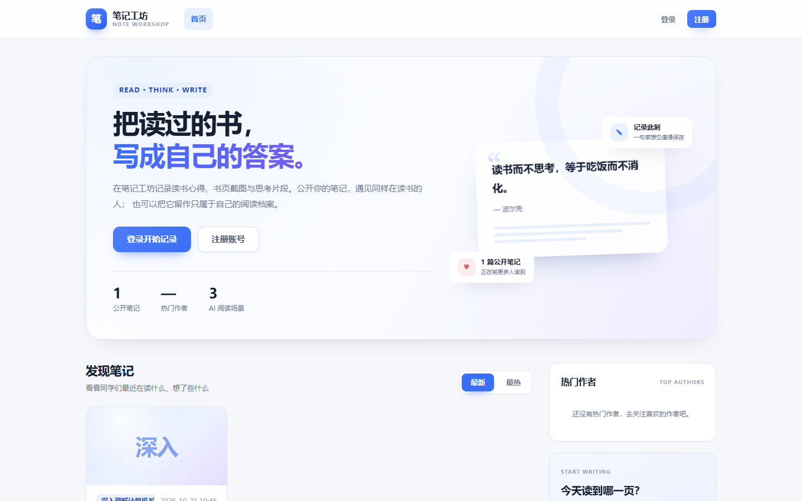
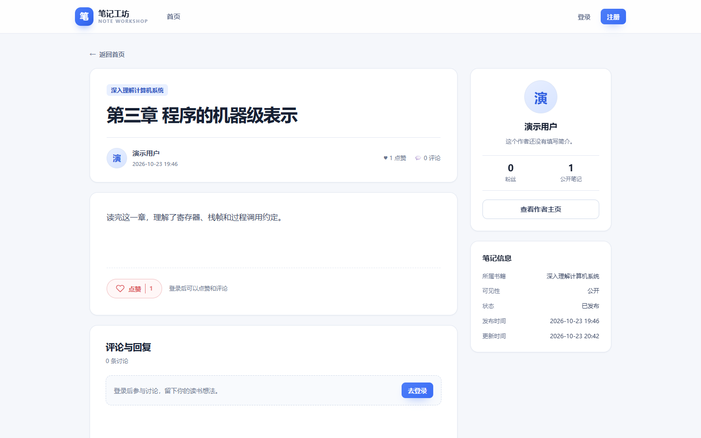
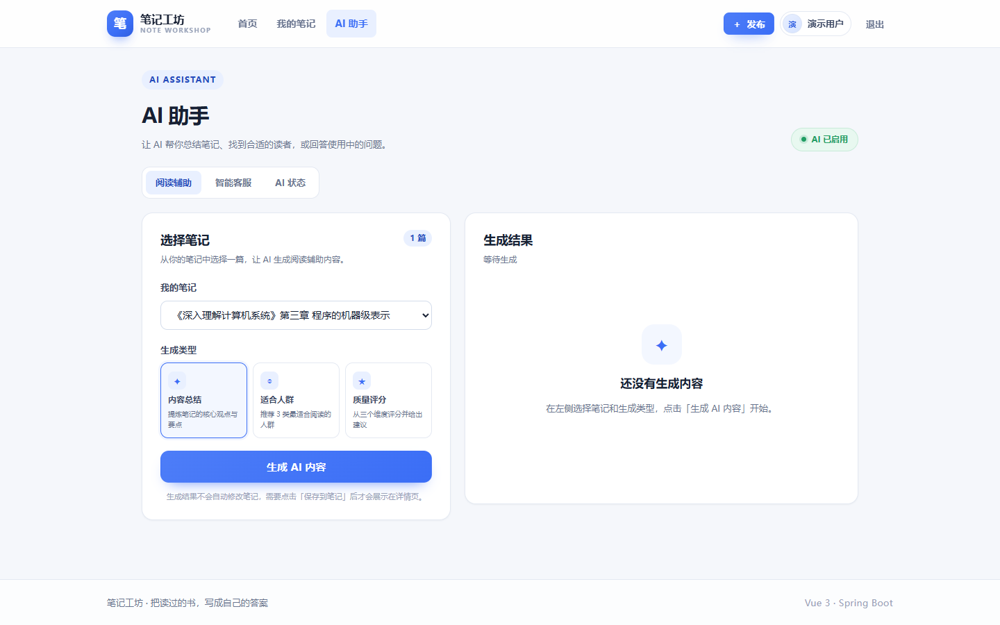
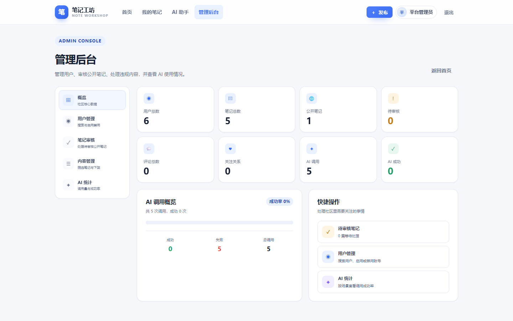

# 笔记工坊 Note-Workshop

> 面向在校学生的读书笔记社区：记录阅读、公开分享、点赞评论、关注作者，AI 只做辅助，思考仍由你完成。


## 界面预览

| 首页 | 笔记详情 |
| --- | --- |
|  |  |

| AI 助手 | 管理后台 |
| --- | --- |
|  |  |

## 功能特性

### 基础功能

- **用户**：注册 / 登录，密码 BCrypt 加密，JWT 鉴权 + 拦截器，未登录访问受保护接口返回 401
- **个人资料**：昵称、简介、头像上传（格式 / 大小校验，本地存储，数据库保存 URL）
- **笔记**：增删改查、必须绑定图书名称、私有 / 公开、多图上传、分页、仅作者可编辑删除
- **点赞**：点赞 / 取消、点赞数、最热排序、我点赞的笔记（分页）
- **工程化**：统一响应 `{code,message,data}`、全局异常处理、HikariCP、SLF4J 业务日志

### 进阶功能

- **审核流**：公开笔记提交后进入待审核，管理员通过后才对外可见；驳回带原因，用户修改后可重新提交
- **管理后台**：数据概览、用户启用 / 禁用、笔记审核与下架、评论删除、AI 调用统计（独立 `AdminInterceptor` 校验角色）
- **评论**：一级评论 + 二级回复，父评论删除级联逻辑删除，管理员可删违规评论
- **社区**：关注 / 取关、粉丝与关注列表、作者主页、热门作者榜（按粉丝数）

### AI（加分项）

- **阅读辅助**：一键总结、适宜人群推荐、质量评分（完整性 / 相关性 / 思考深度）
- **人工确认**：AI 结果不会直接改笔记，需用户手动「保存」，一篇笔记只保留一条 AI 结果
- **智能客服**：多轮对话、会话隔离（越权访问返回业务异常）、最近 20 条消息滑动窗口、历史持久化
- **可观测**：所有 AI 调用写入 `ai_call_log`，后台按场景统计成功 / 失败次数
- **优雅降级**：未配置 Key 时返回 503 并给出提示，不影响其他功能

## 技术栈

| 层次 | 选型 |
| --- | --- |
| 语言 / 运行时 | Java 21（JDK 25 亦可运行） |
| 后端框架 | Spring Boot 3.5.16 |
| 持久层 | MyBatis-Plus 3.5.17 + MySQL 8.4 |
| 鉴权 | JWT（jjwt 0.12.6）+ HandlerInterceptor + BCrypt |
| AI | Spring AI 1.1.8（OpenAI 兼容协议，默认接 DeepSeek） |
| 接口文档 | springdoc-openapi 2.8.9（Swagger UI / OpenAPI 3.0） |
| 前端 | Vue 3 + vue-router 4 + axios，Vue CLI 5 |
| 构建 | Maven 3.9 / npm |

## 系统架构

```
Vue 3 SPA (8081 dev / 8080 打包托管)
        │  axios + JWT
        ▼
Controller  ── 参数校验、统一响应
        │
Service     ── 业务规则、事务、权限判断、AI 调用
        │
Mapper      ── MyBatis-Plus CRUD / 分页
        │
MySQL 8.4   ── user / note / comment / follow / ai_*
```

拦截器链：`AuthInterceptor`（JWT）→ `AdminInterceptor`（ADMIN 角色），CORS 预检放行。

## 目录结构

```
note-workshop
├─ pom.xml
├─ sql/
│  ├─ schema.sql             全量建表
│  └─ upgrade_v2.sql         V1 → V2 升级
├─ docs/
│  ├─ openapi.yaml           OpenAPI 3.0（可导入 Apifox）
│  ├─ api-test-report.md     接口测试报告
│  └─ screenshots/           界面截图
├─ scripts/
│  ├─ api-test.mjs           56 个接口用例
│  ├─ ui-check.mjs           真实浏览器页面检查
│  ├─ ui-flow.mjs            登录 + 发布流程联调
│  └─ gen-openapi.mjs        生成 Apifox 文档
├─ frontend/                 Vue 3（Vue CLI）
└─ src/main/java/com/noteworkshop
   ├─ common/                响应、分页、异常
   ├─ config/                MyBatis-Plus、CORS、OpenAPI、管理员初始化
   ├─ security/              JWT、登录拦截器、管理员拦截器、UserContext
   ├─ user/ note/ comment/ follow/ admin/ ai/ file/
   └─ resources/static/      前端打包产物（由后端托管）
```

## 快速开始

### 环境要求

JDK 21+、Maven 3.6+、MySQL 8.x、Node.js 18+（仅前端开发需要）

### 1. 初始化数据库

```bash
mysql -u root -p < sql/schema.sql
```

默认库名 `note_workshop`，字符集 `utf8mb4`。

### 2. 启动后端

```bash
# 修改 src/main/resources/application.yml 里的数据库账号，或用环境变量覆盖
mvn spring-boot:run

# 或者打包运行
mvn clean package -DskipTests
java -jar target/note-workshop-1.0.0.jar
```

访问 <http://localhost:8080>，接口文档 <http://localhost:8080/swagger-ui.html>。

### 3. 启动前端（开发模式）

```bash
cd frontend
npm install
npm run serve      # http://localhost:8081，已代理 /api 与 /uploads 到 8080
```

生产构建：

```bash
npm run build
# 将 dist/ 覆盖到 src/main/resources/static/ 后重新打包，即可由后端统一托管
```

## 默认账号

| 角色 | 账号 | 密码 | 说明 |
| --- | --- | --- | --- |
| 管理员 | `admin` | `admin123` | 首次启动自动创建 |
| 普通用户 | `demo01` | `123456` | 演示数据 |

## 接口文档与 Apifox

- 在线 Swagger UI：`/swagger-ui.html`
- 离线 OpenAPI：`docs/openapi.yaml`（3.0.1，38 个路径 / 42 个操作，中文摘要）
- **导入 Apifox**：导入数据 → OpenAPI/Swagger → 选择 `docs/apifox-openapi.yaml`（Apifox 专用版，已修正媒体类型、上传接口与鉴权范围）；或填 URL `http://localhost:8080/v3/api-docs.yaml`
- **一键导入（Windows）**：双击 `scripts/import-to-apifox.cmd`，按提示输入项目 ID 与系统级访问令牌；也可运行 `powershell -ExecutionPolicy Bypass -File scripts/import-to-apifox.ps1`
- 导入后在环境里设置 `baseUrl`，登录接口拿到 token 填入 Bearer 鉴权

主要接口分组：认证与用户、笔记、评论、关注与作者、公开接口、管理后台、AI 助手、文件上传。

## 测试

```bash
# 1) 接口全量测试（后端启动后，56 个用例）
node scripts/api-test.mjs

# 2) 页面渲染检查（前端 dev server 启动后，10 个页面 + 控制台报错）
node scripts/ui-check.mjs

# 3) 真实用户流程联调（表单登录 → 发布公开笔记 → 校验待审核）
node scripts/ui-flow.mjs
```

当前结果：接口 **56/56 通过**，页面 **10/10 通过、0 控制台错误**，详见 [测试报告](docs/api-test-report.md)。

## 学习与答辩资料

- [项目代码解析](docs/项目代码解析.md)：模块地图、10 张表、8 个核心机制、设计取舍
- [五日答辩学习计划](docs/五日答辩学习计划.md)：每日学习目标、代码阅读顺序、动手任务与验收标准
- [五日详细讲义](docs/五日学习/README.md)：每天一份，知识点通俗讲解 + 代码逐行 + 自测题
- [答辩题库（50 问速记）](docs/答辩题库.md)：分类整理，每题 3–5 条答题要点
- [答辩题库详解](docs/答辩题库详解.md)：50 题逐题详解，含一句话答案、原理、项目落点与追问
- [项目源码汇编](docs/源码汇编/00-总览.md)：按模块汇编全部 109 个源码文件（后端 / 前端 / SQL 与脚本），含文件清单与行数，可通读或打印

## 配置项

均支持环境变量覆盖，**不要把密钥写进配置文件提交**：

| 变量 | 默认值 | 说明 |
| --- | --- | --- |
| `DB_USERNAME` / `DB_PASSWORD` | `root` / `123456` | 数据库账号 |
| `JWT_SECRET` | 内置开发密钥 | 生产必须替换，≥32 字节 |
| `AI_ENABLED` | `true` | 关闭 AI 时相关接口返回 503 |
| `AI_API_KEY` | 空 | 大模型 API Key（必填才能真实调用） |
| `AI_BASE_URL` | `https://api.deepseek.com` | OpenAI 兼容地址 |
| `AI_MODEL` | `deepseek-chat` | 模型名 |

## 设计说明

- **审核状态机**：`1 已发布 / 2 待审核 / 3 已驳回 / 0 已下架`；公开笔记创建或修改后一律回到待审核
- **权限**：作者本人可改删自己的笔记与评论；管理员可审核、下架、删除违规内容
- **AI 会话隔离**：会话按 `user_id` 校验，越权返回 403；上下文只取最近 20 条消息控制 token 成本
- **AI 结果**：`note_ai` 表对 `note_id` 唯一，保证一篇笔记仅一条辅助结果

## 说明

本项目为面试考核作品，仅供学习交流。上传目录 `uploads/`、构建产物 `target/`、`node_modules/` 已在 `.gitignore` 中忽略；`src/main/resources/static` 保留了前端构建产物，便于 `java -jar` 直接演示。
