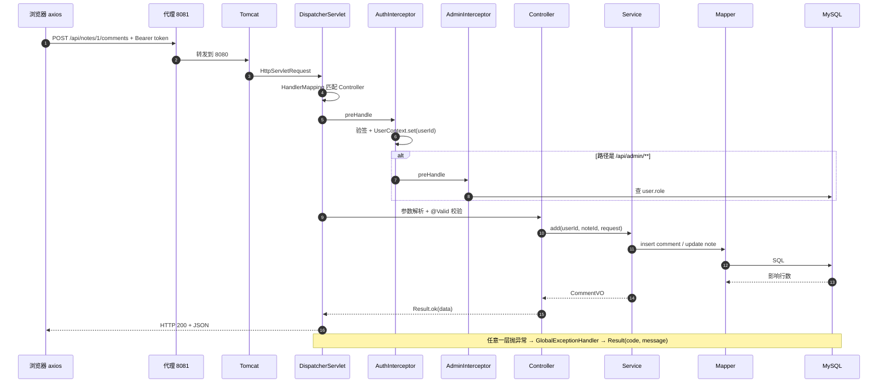

# Day 1 · 全局与数据模型

> 目标：跑起来、当一次用户、说清"项目做什么 + 怎么分层 + 数据怎么存"。
> 时间：上午 2h · 下午 2h · 晚上 1h
> 配套：[五日计划](../五日答辩学习计划.md) · [代码解析](../项目代码解析.md) · [题库](../答辩题库.md)

---

## 0. 今天要解决的三个问题

1. 这个项目**给谁用、解决什么**？（一句话能说清）
2. 一次点击从**浏览器到数据库**经过了哪些层？
3. 10 张表分别**存什么、怎么关联**？

---

## 1. 知识点详解

### 1.1 项目是什么（先讲人话）

大学生读书时笔记散落各处：纸质、备忘录、截图，复习时找不到，也没人交流。

**笔记工坊**做了三件事：

- **沉淀**：把书、笔记正文、书页截图放在一起，私有或公开；
- **交流**：公开笔记可以被点赞、评论、关注作者；
- **辅助**：AI 帮你总结、推荐人群、打分，但**必须你手动确认才保存**。

> 答辩一句话：这是一个"读书笔记 + 社区 + AI 辅助"的三合一系统，核心原则是 **AI 辅助而不代写**。

### 1.2 前后端分离：浏览器只拿数据

**通俗解释**：以前 JSP 是"后厨把做好的菜端上桌"，现在前后端分离是"后厨只给食材（JSON），摆盘（页面）由前端完成"。

- 前端 Vue 跑在浏览器，负责页面与交互；
- 后端 Spring Boot 只返回 `{code,message,data}`；
- 两边靠 HTTP + JSON 通信。

**为什么要分离**：前端可独立开发部署、后端可被 App/小程序复用、职责清晰。

**本项目的两种运行方式**：

| 方式 | 端口 | 用途 |
| --- | --- | --- |
| 开发 | 前端 8081 + 后端 8080 | 改代码热更新，`/api` 由 devServer 代理 |
| 生产 | 后端 8080 托管打包产物 | 一个 jar 就能演示 |

### 1.3 Spring Boot 是什么

**通俗解释**：Spring 是一整套工具箱，Spring Boot 是"帮你把工具箱装好、线接好"的启动器。

- `@SpringBootApplication` = 配置类 + 自动配置 + 组件扫描；
- 内嵌 Tomcat，`main` 方法一跑就有 HTTP 服务；
- `application.yml` 里写端口、数据库、密钥。

对应代码：`src/main/java/com/noteworkshop/NoteWorkshopApplication.java`

```java
@SpringBootApplication
public class NoteWorkshopApplication {
    public static void main(String[] args) {
        SpringApplication.run(NoteWorkshopApplication.class, args);
    }
}
```

启动日志里能看到 Tomcat 端口、数据源、启动耗时——答辩时可以用来证明"服务真的起来了"。

### 1.4 三层架构：接待、后厨、仓库

| 层 | 类比 | 职责 | 本项目例子 |
| --- | --- | --- | --- |
| Controller | 前台接待 | 收参数、校验、转交、包响应 | `NoteController` |
| Service | 后厨 | 业务规则、权限、事务、组装 | `NoteService` |
| Mapper | 仓库管理员 | 只负责取/存数据（SQL） | `NoteMapper` |

**为什么要分层**：

- 改规则只改 Service（比如"公开笔记必须审核"），接口层不用动；
- 好测试、好定位问题、好分工。

**反例**：Controller 里直接写 SQL、Service 里拼 JSON，最后没人知道业务规则在哪。

### 1.5 统一响应：为什么 code 放在 body 里

本项目所有接口都返回：

```json
{ "code": 0, "message": "ok", "data": {} }
```

- `code=0` 成功；`401` 未登录；`403` 无权限；`404` 不存在；`503` AI 不可用；
- HTTP 状态码基本保持 200，业务状态放在 body —— 这是国内常见约定，前端 axios 统一解包。

**好处**：前端只写一套判断；**代价**：不符合严格 REST 语义，监控要看 body。

对应代码：`common/Result.java`、`common/BizException.java`、`common/GlobalExceptionHandler.java`。

### 1.6 分页：别把整张表塞给前端

**通俗解释**：像翻书，一次只给一页。

- 请求：`?page=1&size=10`
- 返回：`{records:[], total:57, page:1, size:10}`
- 后端用 MyBatis-Plus 的 `PaginationInnerInterceptor` 自动拼 `LIMIT`，并限制单页最大 100 条（防止有人传 `size=999999`）。

对应代码：`common/PageResult.java`、`config/MybatisPlusConfig.java`。

### 1.7 一次请求的生命周期（必须能背）

```
浏览器 axios
  → 代理(8081→8080) → Tomcat
  → DispatcherServlet 找到 Controller
  → AuthInterceptor（登录校验）
  → AdminInterceptor（仅 /api/admin）
  → Controller（@Valid 参数校验）
  → Service（业务 + 事务）
  → Mapper（SQL）
  → MySQL
  → Result → JSON
  → 异常则进 GlobalExceptionHandler
```

#### 1.7.1 时序图



#### 1.7.2 逐站说明

| # | 站点 | 做了什么 | 本项目落点 | 可能出错 |
| --- | --- | --- | --- | --- |
| 1 | 浏览器 axios | 对象转 JSON、加 token | `frontend/src/api/index.js:23` | 没登录、JSON 格式错 |
| 2 | 代理 8081→8080 | 开发态转发，浏览器视为同源 | `frontend/vue.config.js` | 后端没启动 → 502 |
| 3 | Tomcat | 解析 HTTP、分配线程 | Spring Boot 内嵌 | 请求体超限、端口占用 |
| 4 | DispatcherServlet | 按路径+方法找 Controller，准备参数 | Spring MVC | 路径不存在 → 404 |
| 5 | AuthInterceptor | 验 token、写 UserContext | `security/AuthInterceptor.java:17` | token 缺失/过期 → 401 |
| 6 | AdminInterceptor | 查库校验 ADMIN | `security/AdminInterceptor.java:19` | 非管理员 → 403 |
| 7 | Controller | `@RequestBody` 反序列化 + `@Valid` | `comment/CommentController.java:33` | 校验失败 → 400 |
| 8 | Service | 业务规则、权限、事务 | `comment/CommentService.java:70` | 业务异常 → 400/403/404 |
| 9 | Mapper | 生成/执行 SQL | `CommentMapper extends BaseMapper` | 唯一索引冲突、SQL 错 |
| 10 | MySQL | 连接池、事务、行锁 | HikariCP + InnoDB | 连接耗尽、死锁 |
| 11 | Result → JSON | Jackson 序列化 | `common/Result.java` | 循环引用、懒加载 |
| 12 | 异常处理 | 统一转 `{code,message}` | `common/GlobalExceptionHandler.java` | 兜底 500 不泄露堆栈 |
| 13 | 前端拦截器 | 解包 `data`、401 跳登录 | `frontend/src/api/index.js:35` | 重复跳转（已加标志位） |

**三个关键细节**：

1. **拦截器在 Controller 之前**，所以未登录请求根本进不了业务代码；
2. **`@Valid` 失败不会进方法体**，直接抛 `MethodArgumentNotValidException`；
3. **事务在 Service 方法上**，方法正常返回才提交，抛 `RuntimeException` 回滚。

#### 1.7.3 异常对照表

| 异常 | 从哪来 | 返回 `code` |
| --- | --- | --- |
| `MethodArgumentNotValidException` | `@Valid` | 400 |
| `BizException(401)` | AuthInterceptor | 401 |
| `BizException(403)` | AdminInterceptor / Service 归属校验 | 403 |
| `BizException(404)` | Service（资源不存在/未公开） | 404 |
| `BizException(503)` | AiService 调用失败 | 503 |
| `MaxUploadSizeExceededException` | 上传超限 | 400 |
| `NoResourceFoundException` | 静态资源不存在 | 404 |
| 其他 `Exception` | 任意层 | 500（只记日志，不返回堆栈） |

> 注意：本项目 HTTP 状态码通常仍是 200，业务结果看 body 的 `code`。

#### 1.7.4 三个最容易讲错的点

1. **拦截器 ≠ 过滤器**：过滤器在 Servlet 层，拿不到 Controller 方法；拦截器在 Spring MVC 内，能拿到 handler、能抛业务异常。
2. **事务边界在 Service**：Controller 不开事务；同类自调用会让 `@Transactional` 失效。
3. **失败也返回 200**：HTTP 状态码表"通信成功"，body 的 `code` 表"业务结果"，这是团队约定。

#### 1.7.5 可能的追问

- `@Valid` 什么时候触发？→ Controller 方法调用前，由参数解析器触发。
- ThreadLocal 什么时候清理？→ `afterCompletion`，preHandle 成功后即使抛异常也会执行。
- 为什么管理员校验查库？→ 角色变更要立即生效，不能等 token 过期。
- Service 里 catch 了异常还会回滚吗？→ 不会，除非重新抛出或手动标记回滚。


用"发表评论"举例最直观：`POST /api/notes/1/comments`。

### 1.8 数据库：把"用户写笔记"翻译成表

**通俗解释**：每张表就是一张 Excel，列是字段，行是一条记录，表之间用 id 关联。

| 表 | 存什么 | 关键点 |
| --- | --- | --- |
| `user` | 用户 | 用户名唯一，密码存 BCrypt |
| `note` | 笔记 | `is_public`（意愿）+ `status`（审核） |
| `note_image` | 配图 | 一篇笔记多张图 |
| `note_like` | 点赞 | **(user_id,note_id) 唯一** |
| `comment` | 评论 | `parent_id` 指向父评论 |
| `follow` | 关注 | **(follower_id,followee_id) 唯一** |
| `note_ai` | AI 结果 | **note_id 唯一**，一篇一条 |
| `ai_call_log` | AI 调用日志 | 统计成功/失败 |
| `ai_chat_session` | AI 会话 | 归属用户 |
| `ai_chat_message` | 会话消息 | user/assistant |

**三条核心关系**：

- 一个用户多篇笔记（1:N）；
- 一篇笔记多条评论，评论自关联（树）；
- 用户与用户多对多关注（通过 `follow`）。

### 1.9 索引：数据库的目录

**通俗解释**：书没有目录，找"审核状态=2"要从第一页翻到最后；有目录直接翻到那一页。

- 主键索引：按 id 查；
- 唯一索引：既加速又防重复（点赞、关注、一篇一条 AI）；
- 联合索引：`(is_public,status,like_count)` 服务"公开 + 已发布 + 按点赞排序"。

**代价**：写入要维护索引、占空间——不是越多越好。

### 1.10 怎么快速读一个 Spring Boot 项目

1. 找入口：`*Application.java`；
2. 看配置：`application.yml`（端口、数据源、密钥）；
3. 列 Controller：知道有哪些接口；
4. 挑一条主流程：Controller → Service → Mapper → 表；
5. 看 `common`：响应、异常、分页是全局约定；
6. 看 `sql/schema.sql`：数据模型是业务的地基。

---

## 2. 代码逐行读：新建笔记

文件：`src/main/java/com/noteworkshop/note/NoteService.java:42-56`

```java
public NoteDetail create(Long userId, NoteRequest request) {
    Note note = new Note();                      // 1. 创建实体（对应 note 表一行）
    note.setUserId(userId);                      // 2. 作者来自登录态，前端传的不算
    note.setBookName(request.bookName());        // 3. 书名必填（DTO 上 @NotBlank 校验过）
    note.setTitle(request.title());
    note.setContent(request.content());
    boolean isPublic = request.isPublic() != null && request.isPublic() == 1;
    note.setIsPublic(isPublic ? 1 : 0);          // 4. 记录用户意愿
    note.setStatus(isPublic ? STATUS_PENDING : STATUS_NORMAL); // 5. 公开→待审核(2)，私有→正常(1)
    note.setLikeCount(0);                        // 6. 计数从 0 开始（冗余字段）
    note.setCommentCount(0);
    noteMapper.insert(note);                     // 7. 插入，MyBatis-Plus 回填自增 id
    saveImages(note.getId(), request.images());  // 8. 配图另存一张表
    return detail(note.getId(), userId);         // 9. 返回完整详情（含图片、作者）
}
```

**逐行要点**：

- 第 2 行：**永远不要相信前端传的 userId**，否则可以冒充别人发笔记；
- 第 5 行：这是审核状态机的入口，也是"公开笔记不能立刻可见"的根本原因；
- 第 9 行：创建后立刻查一次详情，保证返回结构与查询接口一致。

> 答辩追问："第 5 行为什么不直接用 request 里的 status？"——因为 status 是平台审核结果，不能由客户端决定。

---

## 3. 动手任务

### 任务 A：跑起来（30 分钟）

```powershell
start-mysql
cd C:\Users\王准\Documents\deepseek-harness\default-workspace\note-workshop
mvn spring-boot:run
# 另开一个窗口
cd frontend
npm run serve
```

预期：

- 后端日志出现 `Tomcat started on port 8080`；
- 前端出现 `App running at: http://localhost:8081/`；
- 浏览器能打开首页并看到公开笔记。

### 任务 B：走完 8 步用户旅程（30 分钟）

注册 → 登录 → 发一篇公开笔记（提示待审核）→ 退出 → admin 登录 → 后台审核通过 → 前台点赞 + 评论 → 关注作者。

边做边记录：**每个动作调用了哪个接口**（DevTools → Network）。

参考对照表（自己补满 8 行）：

| 动作 | 方法 | 接口 |
| --- | --- | --- |
| 登录 | POST | `/api/auth/login` |
| 发笔记 | POST | `/api/notes` |
| 审核 | POST | `/api/admin/notes/{id}/review` |
| 点赞 | POST | `/api/notes/{id}/like` |
| 评论 | POST | `/api/notes/{id}/comments` |
| 关注 | POST | `/api/users/{id}/follow` |

### 任务 C：查一次数据库（20 分钟）

```sql
USE note_workshop;
SHOW TABLES;
SELECT id,username,nickname,role,status FROM user;
SELECT id,title,is_public,status,like_count,comment_count FROM note ORDER BY id DESC LIMIT 5;
SHOW INDEX FROM note;
```

记录：`note` 表有哪些索引？各自服务什么查询？

### 任务 D：画两张图（40 分钟）

1. 架构图：浏览器 → 代理 → 拦截器 → Controller → Service → Mapper → MySQL；
2. ER 图：10 张表 + 关系 + 3 个唯一索引。

---

## 4. 常见误区

| 误区 | 纠正 |
| --- | --- |
| 以为 `is_public=1` 就对外可见 | 还要 `status=1`（审核通过） |
| 把 `@Transactional` 当万能 | 同类自调用、非 public、异常被吞都会失效 |
| 认为 index 越多越好 | 写放大、占空间，按查询建 |
| 认为 HTTP 200 就是成功 | 本项目看 body 的 `code` |
| 直接信前端传 userId | 服务端从 token 取当前用户 |

---

## 5. 今日自测（6 题）

**Q1** 用三句话介绍这个项目。

<details><summary>参考答案</summary>

面向学生的读书笔记社区；支持私有/公开笔记、审核、点赞评论关注；AI 提供总结/人群/评分与客服，但结果需用户手动确认。
</details>

**Q2** 为什么公开笔记创建后不能立刻看到？

<details><summary>参考答案</summary>

创建时服务端强制把 `status` 设为 2（待审核），公开列表只查 `is_public=1 AND status=1`，必须管理员通过后才可见。
</details>

**Q3** Controller 和 Service 的边界在哪？

<details><summary>参考答案</summary>

Controller 只收参、校验、调用、包响应；业务规则（谁能改、什么状态能点赞、事务）都在 Service；Mapper 只写 SQL。
</details>

**Q4** `(is_public,status,like_count)` 这个索引服务哪条 SQL？

<details><summary>参考答案</summary>

公开流查询：`WHERE is_public=1 AND status=1 ORDER BY like_count DESC`，最左前缀匹配前两列，第三列用于排序。
</details>

**Q5** 统一响应为什么把业务码放 body？

<details><summary>参考答案</summary>

前端统一解包与提示；代价是不符合严格 REST 语义，需要看 body 判断成败。
</details>

**Q6** 10 张表里，哪三张有唯一索引？为什么？

<details><summary>参考答案</summary>

`note_like(user_id,note_id)` 防重复点赞；`follow(follower_id,followee_id)` 防重复关注；`note_ai(note_id)` 保证一篇笔记只留一条 AI 结果。
</details>

---

## 6. 今日复盘（5 分钟）

```markdown
## Day 1 复盘
- 今天讲清楚的概念：
- 仍然模糊的点：
- 明天第一件事：
- 新增的答辩素材：
```

**明天预告**：JWT 全链路、BCrypt、审核状态机的完整流转。
