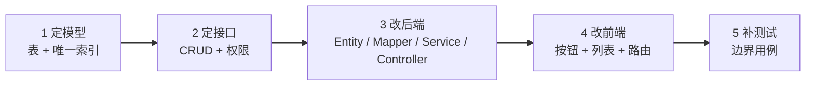

# Day 5 · 演练与模拟答辩

> 目标：把"会"变成"讲得出来、演示不翻车、追问接得住"。
> 时间：上午 2h · 下午 2h · 晚上 1h
> 配套：[五日计划](../五日答辩学习计划.md) · [题库](../答辩题库.md) · [代码解析](../项目代码解析.md)

---

## 0. 今天只做三件事

1. 把 5 分钟 Demo 练到不用想；
2. 把 45 题刷到 80% 能开口；
3. 完整模拟一遍答辩并录音复盘。

---

## 1. 知识点详解

### 1.1 自我介绍：三段式（60 秒）

```
我是谁（10 秒）→ 我做了什么（30 秒）→ 结果/收获（20 秒）
```

**模板**：

> 面试官好，我是×××，计算机相关专业。这五天我完成了一个读书笔记社区项目"笔记工坊"，
> 后端用 Spring Boot + MyBatis-Plus + MySQL，前端 Vue 3，独立完成了用户、笔记、
> 审核、评论、关注、管理后台和 AI 辅助模块。项目已开源，接口测试 56 个用例全部通过。

**忌**：背简历、说"我们团队"、上来讲技术细节。

### 1.2 项目介绍：四段式（3 分钟）

| 段 | 内容 | 时长 |
| --- | --- | --- |
| 背景 | 谁的问题、为什么做 | 20 秒 |
| 方案 | 有哪些角色、核心流程 | 60 秒 |
| 亮点 | 2–3 个技术决策 + 为什么 | 60 秒 |
| 取舍 | 不足与改进 | 40 秒 |

**亮点备选**（挑 2 个讲透，别全说）：

- 审核状态机由服务端强制，前端无法绕过；
- 点赞唯一索引 + 原子计数，简单可靠；
- 评论级联删除用 BFS + 一条批量 UPDATE；
- AI 失败降级 + 日志统计，不拖垮主流程。

### 1.3 Demo 编排：一条主线，不绕路

**原则**：

1. 只走一条主线：登录 → 发布 → 审核 → 互动 → AI；
2. 每一步先"做"再"说一句为什么"，不背长篇；
3. 提前准备好数据（已审核笔记、评论、关注），避免现场冷场；
4. 每个环节想好兜底（数据没了用哪个、接口挂了怎么解释）。

**节奏**：20 秒定位 → 40 秒发布 → 40 秒审核 → 60 秒互动 → 40 秒 AI → 40 秒收尾。

### 1.4 讲架构的模板

不要背目录，按"数据怎么流"讲：

```
浏览器（Vue）→ HTTP/JSON → 拦截器（认证/授权）
→ Controller（校验）→ Service（业务/事务）→ Mapper（SQL）→ MySQL
```

然后补一句关键决策："权限判断放在 Service，因为要拿到资源归属；接口层只做参数校验。"

### 1.5 追问应对：三种情况

| 情况 | 策略 | 示例 |
| --- | --- | --- |
| 会 | 结论 → 展开 → 落到代码 | "JWT 无状态，所以注销要黑名单，我们目前是前端删 token" |
| 半会 | 说已知 + 给思路 | "分库分表我没实践过，思路是按 user_id 分片" |
| 不会 | 承认 + 迁移到相邻知识 | "这个没做过，但类似的××我是这样处理的" |

**忌**：沉默超过 5 秒、编造、和面试官争辩。

### 1.6 现场改需求：五步法

以"加收藏功能"为例：

1. **定模型**：`note_favorite(user_id, note_id, created_at)`，唯一索引；
2. **定接口**：收藏/取消、我的收藏、是否已收藏（详情返回）；
3. **改后端**：Entity/Mapper/Service/Controller，注意唯一索引与计数（可选）；
4. **改前端**：详情页按钮 + 我的收藏页 + 路由；
5. **验**：加 4 个用例（重复收藏、取消、列表、未登录）。

**答题模板**：改哪张表 → 加哪个接口 → 改哪个 Service → 前端加什么 → 怎么测。

### 1.7 应急处理

| 故障 | 现场话术 + 动作 |
| --- | --- |
| 服务没起来 | "我先启动一下数据库和服务"，执行 `start-mysql` + 启动命令 |
| 页面空白 | "可能是缓存"，`Ctrl+F5`；看控制台 |
| 数据为空 | "我现场造一条"，注册 + 发布 |
| AI 503 | "未配置 Key，做了降级"，展示日志与统计 |
| 端口占用 | 换 8081 或结束进程，别现场排查太久 |

**原则**：演示优先，排障其次；超过 30 秒没解决就换方案。

### 1.8 复盘方法：录音 + 三点

听完录音只记三件事：

1. 哪句话卡住了（补一张卡片）；
2. 哪个问题答偏了（回题库找标准要点）；
3. 哪段超时了（删内容或提速）。

### 1.9 结尾三句话

- **亮点**：审核状态机 + 点赞幂等 + AI 降级；
- **不足**：缺单元测试、JWT 无法主动失效、计数弱一致；
- **下一步**：补单测、接 Redis、文件上 OSS。

### 1.10 心态与时间

- 答辩不是考试，是"证明这东西是你做的"；
- 语速放慢，每段先给结论；
- 不会的题不慌，转到相邻知识；
- 留 30 秒缓冲，别卡着时间结束。

---

## 2. 逐字稿模板（可直接改）

### 2.1 一分钟自我介绍

> 各位老师好，我是×××。这次我独立完成了一个面向学生的读书笔记社区"笔记工坊"。
> 后端是 Spring Boot + MyBatis-Plus + MySQL，前端 Vue 3，包含用户、笔记、审核、
> 评论、关注、管理后台和 AI 辅助七个模块。项目已开源，56 个接口用例全部通过，
> 前端 10 个页面无控制台报错。下面我用 5 分钟演示核心流程。

### 2.2 三分钟项目介绍

> **背景**：学生读书笔记分散、缺少复盘与交流，所以做了一个"记录 + 社区 + AI 辅助"的系统。
>
> **方案**：用户注册登录后可写私有/公开笔记；公开笔记要经过管理员审核；其他人可以点赞、
> 评论、关注作者；AI 可以总结、推荐人群、打分，但结果必须用户确认才保存。
>
> **亮点**：第一，审核状态机放在服务端，前端传什么都不能绕过；第二，点赞用唯一索引加
> 原子计数，保证不重复、不丢更新；第三，AI 调用失败会降级并记录日志，不影响主流程。
>
> **取舍**：目前没有单元测试，JWT 也无法主动失效，这两块是我下一步要补的。

---

### 1.11 Demo 时间轴

```mermaid
timeline
    title 5 分钟 Demo 时间轴
    0:00 : 首页定位（公开流 + 热门作者）
    0:20 : demo01 发布公开笔记（提示待审核）
    1:00 : admin 登录后台审核通过
    1:40 : 回前台点赞、评论、回复、关注
    2:40 : AI 助手生成总结并保存到笔记
    3:20 : 我的笔记状态标签、作者主页
    4:00 : 收尾（架构一句话 + 亮点/不足/下一步）
```

### 1.12 现场改需求流程



以「收藏」为例，五步对应的落点：

| 步骤 | 具体动作 | 对应文件 |
| --- | --- | --- |
| 1 定模型 | `note_favorite(user_id,note_id,created_at)` + 唯一索引 | `sql/schema.sql` |
| 2 定接口 | 收藏/取消、我的收藏、详情返回 `favorited` | 新建 `FavoriteController` |
| 3 改后端 | 仿 `NoteService.toggleLike` 写 Service | `note/` 或新建 `favorite/` |
| 4 改前端 | 详情页按钮 + 我的收藏页 + 路由 | `NoteDetailView.vue`、`router/index.js` |
| 5 补测试 | 重复收藏、取消、列表、未登录 401 | `scripts/api-test.mjs` |

### 1.13 Demo 逐站表

| 时间 | 动作 | 讲解点 | 失败兜底 |
| --- | --- | --- | --- |
| 0:00 | 打开首页 | 项目定位 + 公开流 | 硬刷新 |
| 0:20 | 发布公开笔记 | 服务端强制 `status=2` | 用已有笔记演示 |
| 1:00 | 管理员审核 | 双拦截器 + 审核边界 | 直接展示已通过笔记 |
| 1:40 | 点赞/评论/关注 | 唯一索引、级联、统计 | 用已有点赞/评论 |
| 2:40 | AI 生成 + 保存 | 人工确认、一篇一条 | 说明 503 降级 |
| 3:20 | 我的笔记/作者主页 | 状态机与权限 | 切后台看数据 |
| 4:00 | 收尾 | 亮点/不足/下一步 | — |

## 3. 动手任务

### 任务 A：Demo 三遍计时（60 分钟）

1. 第一遍：正常流程，计时；
2. 第二遍：故意停掉后端再恢复，练应急话术；
3. 第三遍：清空浏览器缓存、用无痕窗口，模拟陌生环境。

记录：每遍总时长、卡壳点、超时环节。

### 任务 B：题库三轮（60 分钟）

- 第一轮：45 题口述，答不上标记；
- 第二轮：只看标记题，写关键词；
- 第三轮：随机 10 题，1 分钟/题。

目标：至少 36 题能开口。

### 任务 C：现场改需求（30 分钟）

从下面挑一个，按五步法写出方案（不必真写完代码）：

- 收藏功能；
- 笔记标签；
- 评论点赞；
- 笔记浏览量；
- AI 结果导出 Markdown。

### 任务 D：模拟答辩（30 分钟）

1. 自我介绍 1 分钟 + 项目介绍 3 分钟 + 随机 10 问；
2. 全程录音；
3. 回听，记 3 条改进；
4. 立刻重录一遍改进后的版本。

---

## 4. 常见误区

| 误区 | 纠正 |
| --- | --- |
| 演示时讲实现细节 | 先让老师看到效果，再解释一句为什么 |
| 追问题时长篇大论 | 先结论，再展开，30 秒一段 |
| 不会的题硬编 | 承认 + 给思路，诚信比正确更重要 |
| 把不足藏起来 | 主动说 + 给改进方案，反而加分 |
| Demo 走支线 | 只走主线，支线留到提问环节 |

---

## 5. 今日自测（5 题）

**Q1** 用 30 秒介绍项目。

<details><summary>参考答案</summary>

面向学生的读书笔记社区，支持私有/公开笔记、审核、点赞评论关注，AI 辅助总结与客服；后端 Spring Boot + MySQL，前端 Vue 3，56 个接口用例通过。
</details>

**Q2** 你最大的技术难点是什么？

<details><summary>参考答案</summary>

审核状态机与权限的边界：状态必须服务端强制、修改后重新审核，同时要保证私有笔记作者可见、他人不可见。
</details>

**Q3** 如果现场让你加收藏，你怎么做？

<details><summary>参考答案</summary>

新表 + 唯一索引 → 4 个接口 → Service 校验归属 → 前端按钮与列表页 → 补 4 个用例。
</details>

**Q4** 项目有什么不足？

<details><summary>参考答案</summary>

缺单元测试、JWT 无服务端失效、点赞计数弱一致、文件存本地、AI 同步无流式。
</details>

**Q5** 重做一次你会改什么？

<details><summary>参考答案</summary>

先定 OpenAPI 再写代码；补 Service 单测；引入 Redis 做缓存与计数；密钥全部外置。
</details>

---

## 6. 答辩当天清单

- [ ] MySQL、后端、前端都已启动并验证
- [ ] demo01 / admin 可登录
- [ ] 有已审核笔记、评论、关注数据
- [ ] 浏览器标签：首页 / 后台 / AI / Swagger
- [ ] 手机存图：架构、ER、状态机
- [ ] 三句话：亮点 / 不足 / 下一步
- [ ] 提前 10 分钟到场，检查投影与网络

---

## 7. 复盘模板

```markdown
## 模拟答辩复盘
- 卡住的题：
- 超时的环节：
- 需要补的卡片：
- 明天答辩前最后确认：
```
